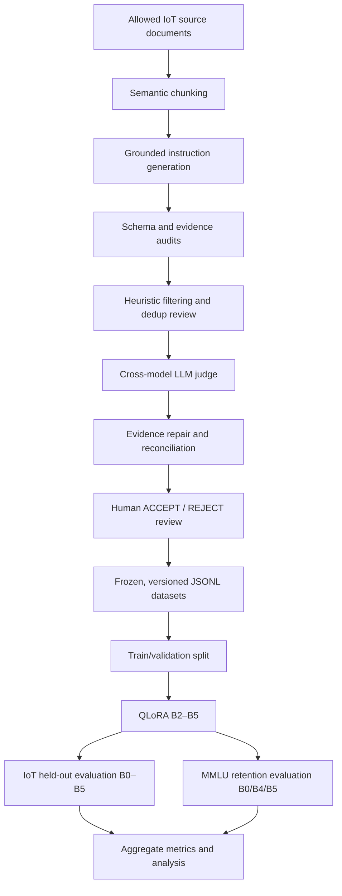

# Dataset Pipeline Architecture

## End-to-end architecture

## Workflow

1. Source ingestion and semantic chunking with stable chunk identifiers.
2. Grounded generation of QA, extraction, and classification examples with resumable checkpoints.
3. Structural and evidence audits: JSONL structure, unique IDs, source references, and evidence-block reconstruction.
4. Heuristic filtering and duplicate review.
5. Cross-model judging and persistent judge-result reconciliation.
6. Evidence repair and candidate reconciliation.
7. Human review gate requiring explicit ACCEPT/REJECT decisions.
8. Phase 3 dataset preparation with schema validation and evidence provenance checks.
9. QLoRA training for B2–B5.
10. Held-out task evaluation and general-retention evaluation.

## Key scripts

| Stage | Scripts |
|---|---|
| Chunking | `scripts/08b_create_semantic_chunks.py` |
| Initial generation | `scripts/29_generate_production_batch.py` |
| Improved generation | `scripts/38_generate_improved.py`, `scripts/41_generate_improved_safe.py` |
| Production v2 | `scripts/55_generate_production_v2.py`, `scripts/60_generate_production_v2_resumable.py` |
| Audits | `scripts/31_audit_generated_examples.py`, `scripts/32_audit_evidence_blocks.py`, `scripts/42_audit_improved_pilot.py`, `scripts/56_audit_generation_v2.py`, `scripts/61_audit_generation_v2.py` |
| Filtering/reconciliation | `scripts/45_production_heuristic_filter.py`, `scripts/46_apply_approved_deduplication.py`, `scripts/48_reconcile_judge_results_fixed.py`, `scripts/49_repair_evidence_candidates.py`, `scripts/51_repair_hma_evidence.py`, `scripts/54_finalize_judge_reconciliation.py`, `scripts/59_merge_and_audit_validated_pool.py` |
| Judge evaluation | `scripts/28_evaluate_dataset.py`, `scripts/36_evaluate_dataset_groq.py`, `scripts/43_evaluate_improved_pilot_groq.py`, `scripts/50_judge_repaired_examples_groq.py`, `scripts/53_judge_hma_repair_groq_fixed.py`, `scripts/58_judge_v2_candidates_groq.py` |
| Human review | `scripts/44_prepare_human_audit_30.py`, `scripts/57_apply_v2_manual_review.py` |
| Phase 3 export | `training/prepare_phase3_datasets_v2.py` |
| Model training | `training/train_iot_baseline.py` |

## Reproducibility boundary

These source scripts were recovered from project uploads and committed with their original filenames. Their original working-directory assumptions are preserved. The original data and source documents are not included.

The original orchestration files are now included: root-level `pipeline.py`, root-level `pipeline_config.json`, and `scripts/pipeline_judge.py`. The runner expects the frozen corpus under `data/frozen/` and the generated/interim data paths defined in the configuration; those data files are not bundled in the public repository.
